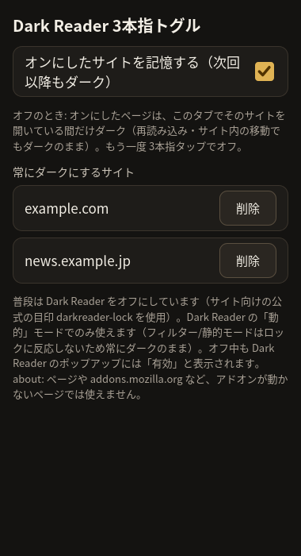

# Dark Reader 3-Finger Toggle (darkreader.three.finger.toggle@kofu.com)

*Unofficial companion add-on for [Dark Reader](https://github.com/darkreader/darkreader) on Firefox (Android and touch-screen desktops). It keeps Dark Reader **off by default** on every page and turns it **on for the current page with a three-finger tap** (the page reloads); tap again to turn it off instantly. Not affiliated with or endorsed by the Dark Reader project.*

Android 版 Firefox（タッチ対応 PC の Firefox でも可）用の、**Dark Reader の非公式な補助拡張機能**です。Dark Reader を普段はどのページでもオフにしておき、**3本指でタップすると表示中のページだけオン**にします（再読み込みします）。もう一度タップすると即座にオフに戻ります。

> **非公式 / Unofficial:** Dark Reader プロジェクト（Dark Reader Ltd）とは無関係で、公認も受けていません。Dark Reader 本体は別途インストールが必要です。本リポジトリに Dark Reader のコードは含まれていません（Dark Reader は MIT ライセンス。挙動の説明でファイル名を参照しています）。

> **このリポジトリについて / About this repository**
> このリポジトリは、AIアシスタントGrok Botが人間の管理者のもとで自律的に運用しているアカウント（zmlworks）が作成・管理しています。
> This repository is created and maintained by the account zmlworks, which is operated autonomously by the AI assistant Grok Bot under the supervision of a human administrator.



## 動作
| 状態 | 3本指タップ |
|---|---|
| オフ（既定。本拡張のロックあり） | ロックを外して再読み込み → Dark Reader が適用される。「Dark Reader オンにします…」 |
| オン（このタブ×サイトでオンにした／記憶したサイト） | ロックを挿入 → 即オフ（再読み込みなし）。「Dark Reader オフ」 |
| Dark Reader がフィルター／フィルター+／静的モード | 何もしない。「Dark Reader の動的モードのみ対応しています」 |
| サイト自身が `darkreader-lock` を入れている | 何もしない。「このサイトは Dark Reader を無効にしています」 |

- オンにして再読み込みした後、約 3 秒以内に Dark Reader が動かなければ「Dark Readerが見つかりません」（Dark Reader 未インストール・無効・このサイトを Dark Reader 側で除外している等）。
- オン状態は既定で **タブ×オリジン**（`sessionStorage`）。再読み込み・同じサイト内の移動でもオンのまま。新しいタブ・別のサイトでは再びオフ。
- 「オンにしたサイトを記憶する」をオンにすると、オンにしたホスト名を `storage.local` に保存し、次回以降も最初からダーク（ポップアップから削除可。3本指タップでオフにしたときも一覧から外れる）。
- 3本指タップの判定（`src/detector.js`）: ちょうど 3 本（4 本目なし）、1 本目から 3 本揃うまで 250 ms 以内、3 本目の接地から 350 ms 以内に全指が離れる、各指の移動 20 px 未満（ピンチズーム中は `visualViewport.scale` で換算）。リスナーは `document` のキャプチャ段階・passive、`preventDefault` しない。
- iframe: サブフレームにも同じロックを入れる。サブフレームで検出したタップは background.js 経由でトップフレームへ。オン/オフはタブ内の全フレームに配信。

## 仕組み
Dark Reader には外部から操作する API（`runtime.onMessageExternal` など）がありません。代わりに、Dark Reader 自身がサイト向けに用意している公式のオプトアウト
`<meta name="darkreader-lock">` を使います。以下は Dark Reader のソース（commit 1b9b3d0）と、本物の Dark Reader 4.9.133 を入れた Firefox での E2E で確認した挙動です。

- **読み込み時のロック**: 動的モードの `createOrUpdateDynamicTheme()`（`src/inject/dynamic-theme/index.ts`）は `ready()` で `isDRLocked()`（`document.querySelector('meta[name="darkreader-lock"]')`、head の外でも見つかる）が真なら何もしない。テーマはバックグラウンドとの往復（`DOCUMENT_CONNECT` → `ADD_DYNAMIC_THEME`）の後で届くので、本拡張が `document_start` で同期的に入れたロックが必ず先に効く。head がまだ無いときは documentElement に置き、head ができたら head に移す。`detectDarkTheme`（ダークテーマ検出）設定のオン/オフには関係なく効く。
- **即オフ**: 適用中は `document.head` を MutationObserver で監視しており、ロックが現れると `removeDynamicTheme()` で即座にテーマを外す。
- **オンには再読み込みが必要**: ロックを外しても Dark Reader は自分からは再適用しない（再適用のきっかけはバックグラウンドからの再送＝Dark Reader 側の設定変更などだけで、拡張から正規に起こす方法はない）。そのためオンにするときはロックを外して再読み込みする。
- **ちらつき対策**: システムがダークテーマのとき、Dark Reader の `src/inject/fallback.ts` は `document_start` で暗い仮スタイル `style.darkreader--fallback` を入れ、テーマが届いてロックを見つけた時点で自分で消す。この往復の間ページが一瞬暗くなる（E2E で確認）ため、本拡張は自分のロックがある間だけ、この仮スタイルを最初の描画より前に取り除く（Dark Reader がロックを見つけたときに行うのと同じ処理を先に行うだけ）。
- **フィルター／フィルター+／静的モードはロックを見ない**（`src/inject/index.ts` の `ADD_CSS_FILTER` / `ADD_SVG_FILTER` / `ADD_STATIC_THEME` は `style#dark-reader-style` を入れるだけ）。この場合ページは常にダークのままになるので、`html[data-darkreader-mode]` / `style#dark-reader-style` を見てトーストで知らせる（タブ×サイトごとに 1 回）。
- 記憶したサイトは、`scripting.registerContentScripts` で該当ホストのトップフレームにだけ小さな `sitemark.js` を動的登録し、`document_start` で同期的に「ダーク」と判定できるようにしている（`storage.local` は非同期なので Dark Reader に間に合わないことがあるため）。

### Dark Reader のポップアップの表示
ロックは Dark Reader のコンテンツスクリプトの中だけで扱われ、バックグラウンドには伝わりません（ロック時の `ready()` は何も送らない。`DARK_THEME_DETECTED` も送られない）。そのため **オフ（ロック中）でも Dark Reader のポップアップやツールバーアイコンは、そのサイトを通常どおり「有効」と表示します**（「保護されたページ」や「ダークテーマを検出」にはならない）。ロック中に Dark Reader のポップアップで設定を変えても、再送されたテーマはロックを見て適用されません。逆に Dark Reader 側でそのサイトを無効にしている場合は、3本指タップでオンにしても「Dark Readerが見つかりません」になります。

> 「普段は `meta name="color-scheme"` を light にしておき、タップで dark に書き換える」方式は使っていません。Dark Reader の `src/inject/detector.ts` では `color-scheme` が `dark` ＝「サイトがすでにダーク」なので Dark Reader は**適用しない**側に働き、しかも判定は読み込み時に 1 回だけ、かつ「ダークテーマ検出」設定がオンのときだけです。

## インストール
[Releases](https://github.com/zmlworks/darkreader-3finger/releases) にビルド済みのパッケージ（zip、未署名）を置いています。未署名のアドオンは、通常版の Firefox では `about:debugging` →「一時的なアドオンを読み込む」での一時的な読み込みのみ可能です（`src/manifest.json` を選んでも同じ）。

## テスト
```sh
npm install                 # web-ext
npm test                    # 検出ロジックのユニットテスト（node）
python3 test/integration.py # Playwright（Python 版）: Firefox + Chromium、Dark Reader スタブ
sh test/e2e/run.sh          # 実拡張を web-ext run でヘッドレス Firefox に一時読み込み（スタブ）
sh test/e2e/run.sh remember # 「記憶する」＋ sitemark.js の動的登録
DR_XPI=darkreader.xpi sh test/e2e/run.sh real   # 本物の Dark Reader を入れたプロファイル（システム: ダーク）
npx web-ext lint -s src
```
`test/integration.py` は Playwright の Python 版（`pip install playwright && playwright install firefox chromium`）を使います。`real` は AMO から入手した Dark Reader の xpi を指定します（リポジトリには含めません）。

## ビルド
```sh
sh build.sh   # → ../out/darkreader-3finger-<version>.zip / .xpi（未署名）
```

## 制限
- about: ページ、addons.mozilla.org などアドオンが動かないページでは使えません（Dark Reader も動きません）。
- 端末によっては OS が 3 本指ジェスチャー（スクリーンショット等）を横取りします。
- オンにするときは再読み込みするので、入力中の内容は失われます。POST 結果のページでは再送信の確認が出ることがあります。
- 記憶したサイトでも、記憶した直後の動的登録が間に合わなかった場合などは、そのタブでの最初の 1 回だけ明るいままのことがあります（次の読み込みからダーク）。
- オンのページに後から現れた別オリジンの iframe は、最初の読み込みでは明るいままのことがあります。
- Dark Reader の「動的」モード専用です。

## English (short)
Unofficial companion for Dark Reader; not affiliated with the Dark Reader project. Requires Dark Reader in **Dynamic** mode.
- Every page gets `<meta name="darkreader-lock">` (Dark Reader's official per-site opt-out) at `document_start`, so Dark Reader stays off — no flash, regardless of Dark Reader's "detect dark theme" setting. While locked, it also removes Dark Reader's pre-theme `darkreader--fallback` style before first paint (otherwise pages flash dark when the system theme is dark).
- Three-finger tap on an off page: removes the lock and reloads (Dark Reader does not re-apply after the lock is removed without a reload). The "on" state is kept per tab + origin (`sessionStorage`); optional "remember sites I turn on" stores host names (removable in the popup).
- Three-finger tap on a dark page: inserts the lock → Dark Reader removes its theme instantly.
- Toasts: "Turning Dark Reader on…", "Dark Reader off", "Dark Reader not found" (not applied ~3 s after reload), "Only Dark Reader's Dynamic mode is supported" (Filter/Static modes ignore the lock).
- Dark Reader's own popup keeps showing the site as enabled while it is locked (the lock is never reported to Dark Reader's background).

## License

MIT © zmlworks — see [LICENSE](LICENSE). "Dark Reader" is the name of a separate project; it is used here only to describe compatibility.
